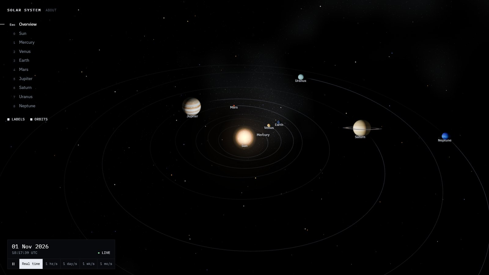
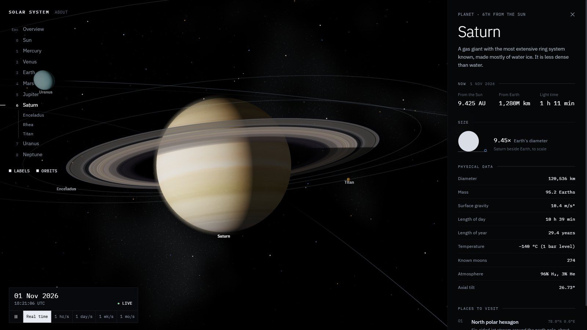
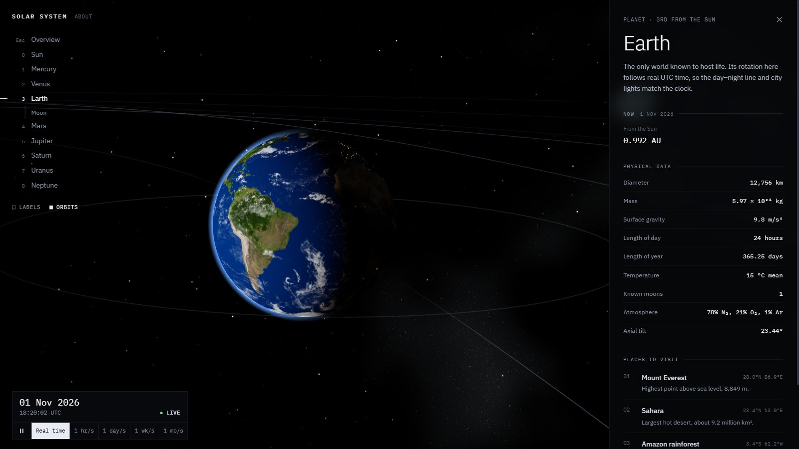

# Solar System

An interactive 3D model of the Solar System that you can travel through. Every planet sits where it really is today, Earth turns with the real clock, and you can fly to any planet or major moon and visit specific places on its surface, from Apollo 11's landing site to the Great Red Spot.

**[Open it in your browser →](https://solar-3js.pages.dev/)**



## What you can do

- **See the Solar System as it is right now.** Planet positions are calculated for the current date and time, so the view matches the real sky. Run time forward at up to a month per second to watch the inner planets lap the outer ones, then return to now.
- **Fly anywhere.** The Sun, all eight planets and thirteen major moons. The camera flies to the body you pick and stays with it as it moves along its orbit.
- **Look around in every direction.** Orbit a planet all the way round, over the poles included, or turn the camera where it stands to look at the Milky Way behind you.
- **Visit places on the surface.** Pick a landmark and the camera settles above that exact latitude and longitude, then turns with the ground beneath it.
- **Read a fact sheet for each body.** NASA physical data, a to-scale size comparison with Earth, and live values for the simulated date: distance from the Sun and from Earth, and how long light takes to cross that distance.



### Places to visit

| Body | Landmarks |
| --- | --- |
| Mercury | Caloris Basin |
| Venus | Maxwell Montes, Venera 13 landing site (on the radar map of the surface) |
| Earth | Mount Everest, Sahara, Amazon rainforest, Mariana Trench |
| Moon | Apollo 11 at Tranquility Base, Apollo 17 at Taurus–Littrow, Tycho, Mare Imbrium, Shackleton crater |
| Mars | Olympus Mons, Valles Marineris, Gale Crater (Curiosity), Jezero Crater (Perseverance), Hellas Planitia |
| Jupiter | Great Red Spot |
| Io | Loki Patera |
| Saturn | North polar hexagon |
| Enceladus | Tiger stripes |
| Titan | Huygens landing site |

## How accurate it is

**Positions.** Planets are placed with the Keplerian elements and century rates from JPL's *Approximate Positions of the Planets*. For each frame the elements are advanced to the simulated date, Kepler's equation is solved for the true anomaly, and the result is rotated into ecliptic coordinates. JPL quotes this method as accurate to well under a degree between 1800 and 2050. The orbit lines are the true ellipses from the same elements.

**Rotation.** Earth's rotation is driven by Greenwich mean sidereal time, so the day–night line and the city lights on the night side match the real UTC clock. The Moon's phase follows the synodic month. Every planet spins at its real rate about its real axial tilt, including Venus's slow retrograde rotation and Uranus lying on its side. Saturn's rings sit in its equatorial plane, with the planet's shadow falling across them.

**The sky.** The Milky Way comes from an all-sky survey image in galactic coordinates, rotated into the ecliptic frame of the scene, so the galactic centre lies in Sagittarius and the Magellanic Clouds are in the southern sky, where they belong. The image's band is only a few brightness levels above black, so its diffuse glow is rebuilt in floating point, and the band itself is drawn as 80,000 faint stars placed by the survey's own brightness. That keeps its star clouds and dark dust lanes sharp at any zoom.

**Light.** Planets are lit only by the Sun at the origin, in custom shaders: a soft terminator where there is a thick atmosphere, limb darkening on the gas giants, and an atmospheric rim only on the sunlit side. The Sun's disc uses a standard limb-darkening law.

**What is not to scale.** At true scale the planets would be invisible specks, so sizes and distances are compressed to fit on one screen. Directions, orbital shapes, tilts and timing are all real. The positions of moons other than our own are illustrative, though their orbital periods are real.



## Controls

| Action | Mouse / touch | Keyboard |
| --- | --- | --- |
| Orbit the selected body | Drag | Arrow keys |
| Look around from where you are | Right-drag, Shift + drag, or two-finger drag | Shift + arrow keys |
| Zoom | Scroll or pinch | `+` / `−` |
| Face the target again | Double-click | `R` |
| Go to a planet | Click it, its label or its name in the list | `1`–`8` (`0` for the Sun) |
| Back to the overview | Close the fact sheet | `Esc` |
| Pause or resume time | Play/pause button | `Space` |

## Performance

There is no full-screen post-processing: the Sun's glow is drawn as two camera-facing quads rather than a bloom pass, and the sky is one shader on a sphere plus point sprites. Per-frame work is mostly the planets themselves, so it runs smoothly on integrated graphics and phones. The heavy 3D bundle is lazy-loaded, so the interface appears before the textures finish loading.

## Built with

React 19, Vite, three.js through `@react-three/fiber` and `drei`, custom GLSL shaders, Zustand for state, Framer Motion and Tailwind CSS.

```
src/
  components/   Scene, Planet, Moon, Sun, StarField, CameraController, BodyPanel, TimeBar, …
  shaders/      body, sun, ring and atmosphere shaders
  utils/        orbital mechanics, body data, sky frame, simulation clock
  store/        view state (focus, time rate, display options)
public/textures/  2K planet, ring and Milky Way maps
```

## Run it locally

```bash
npm install
npm run dev
```

`npm run build` produces a production bundle in `dist/`, and `npm run lint` runs oxlint.

## Credits

- Textures: [Solar System Scope](https://www.solarsystemscope.com/textures/), licensed under CC BY 4.0
- Physical data: [NASA Planetary Fact Sheets](https://nssdc.gsfc.nasa.gov/planetary/factsheet/)
- Orbital elements: [JPL Approximate Positions of the Planets](https://ssd.jpl.nasa.gov/planets/approx_pos.html)

Made by [Harsha Lolewar](https://harsha-lolewar.pages.dev/).
